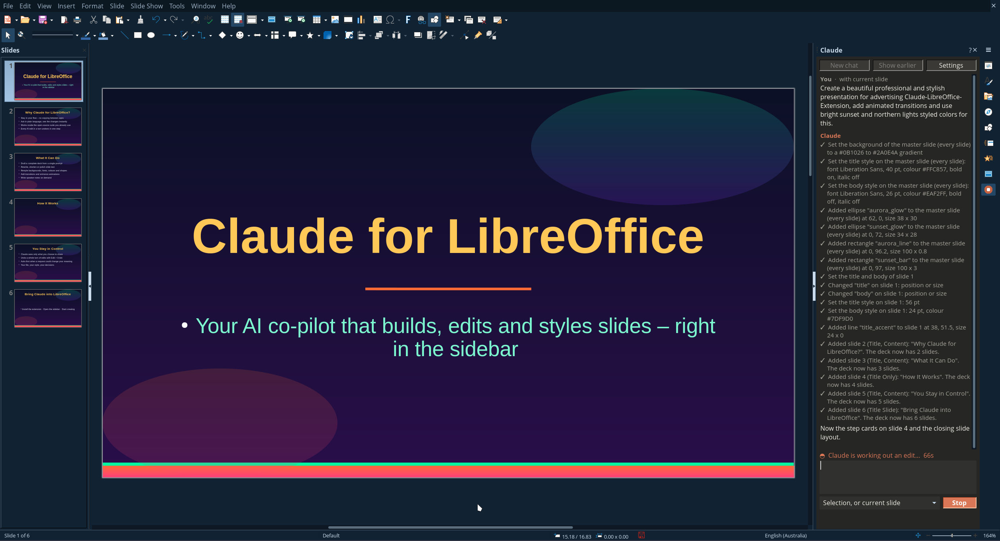
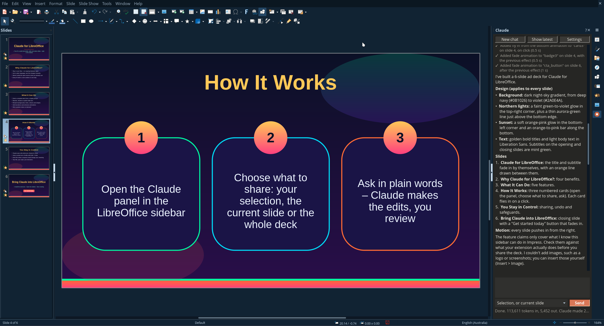
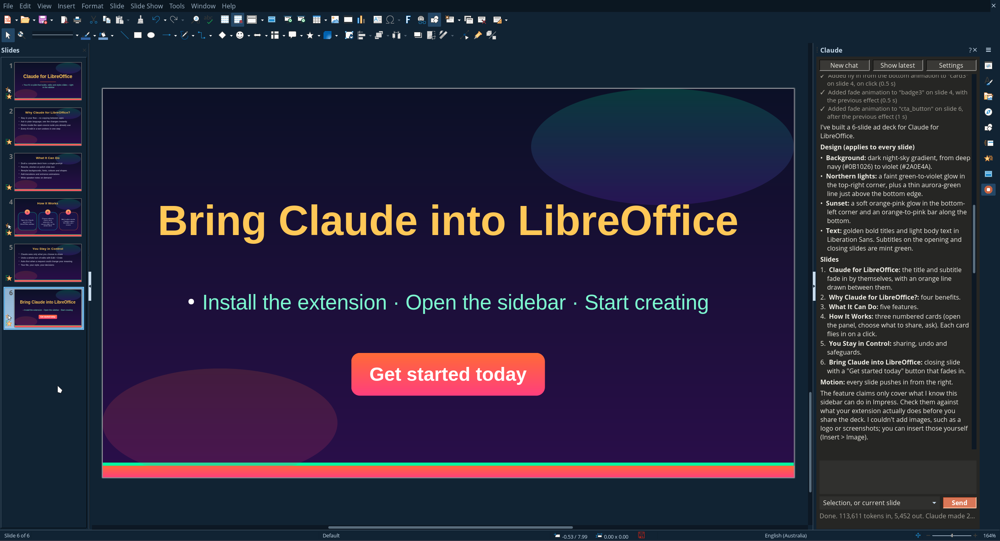

# Claude for LibreOffice (unofficial)

A sidebar panel that lets you chat with Claude inside LibreOffice Writer, Calc and Impress. Claude can read the part of your file you choose to send, answer questions about it, and make edits when you ask. It works much like the Claude add-in for Word, but for LibreOffice.

This is an independent project. It is not made, endorsed or supported by Anthropic or by The Document Foundation.

Current version: 0.10.0. It is early software that has had one person using it, so expect rough edges (see [Status and limits](#status-and-limits)).

## Screenshots

### Impress

Claude building a six-slide deck from one request. The panel lists each edit as Claude makes it.



The finished "How It Works" slide, with Claude's summary of the deck in the panel.



The closing slide, with a "Get started today" button that fades in.



## What you need

- LibreOffice 26.2 or newer. It has only been tested on 26.2.
- An Anthropic API key. Create one at console.anthropic.com. Usage is billed to you by Anthropic, per token. This project does not use a Claude.ai login.
- An internet connection. Requests go straight from your computer to api.anthropic.com.

## Install

1. Download `claude-libreoffice.oxt`, or build it yourself (see [Build it yourself](#build-it-yourself)).
2. In LibreOffice, open Tools > Extensions, choose Add, and pick the file.
3. Restart LibreOffice.
4. Open a Writer, Calc or Impress document and click the Claude icon in the sidebar tab bar. If the sidebar is hidden, use View > Sidebar.
5. Click Settings in the panel, paste your API key, choose a model, and press OK.

If you upgrade from a very early build and the Claude tab does not show up in Calc or Impress, LibreOffice may be holding an old copy of the tab's settings. Close LibreOffice, open `registrymodifications.xcu` in your profile folder (for example `~/.config/libreoffice/4/user/` on Linux), and delete the two `<item>` entries that mention `ClaudeDeck` and `ClaudePanel`. Keep a backup first.

## Using it

Type a message and press Enter to send. Shift+Enter starts a new line. Esc or the Stop button cancels a running request.

A menu under the message box controls what document content goes with each message:

| App | Choices |
| --- | --- |
| Writer | Selection or whole document (the default), selected text only, whole document, nothing |
| Calc | Selection or active sheet (the default), selected cells only, active sheet, nothing |
| Impress | Selection or current slide (the default), whole deck, nothing |

The panel says what it sent with each message, for example "active sheet (240 cells)". Text that has not changed since Claude last saw it is not sent again.

When you ask for a change, Claude makes it with editing tools. Each edit appears as a line in the transcript, and everything Claude changes in one turn is a single undo step, so one Edit > Undo takes it all back. There are two exceptions, and the status line says when either applies:

- In Writer, LibreOffice records adding a header or footer as its own undo step, so a turn that adds one takes two or three Undos to reverse. Once that step is undone, LibreOffice can't redo the steps after it.
- In Calc, LibreOffice can't undo frozen rows and print settings, so Undo leaves them in place.

In Writer you can also turn on a setting that records Claude's edits as tracked changes.

Writer has two extra buttons, Insert at cursor and Replace selection, which place the text from Claude's last reply into the document.

### Writer

Claude can replace text, insert paragraphs and tables, delete paragraphs, add and delete table rows, and add comments. It can also style: character formatting (font, size, colour, highlight), paragraph formatting (style, alignment, spacing, indent, background), whole-document changes to a paragraph style such as Heading 1 or Body Text, and table styling (header colours, banded rows, borders). It makes real bulleted and numbered lists (a new numbered list starts at 1), page breaks, a header and footer with page numbers ("Page 3 of 5"), landscape pages and text columns, and a table of contents built from the headings. Tables repeat their header row on each page.

The document view starts with a line listing the styles in use, and marks each heading, list item and page break, so Claude can match the look you already have. In an empty document Claude writes straight into it, then styles what it wrote.

Claude can empty a header or footer but not turn it off: removing one asks you to confirm in a dialog, so do that yourself with Insert > Header and Footer. Page margins and images are not supported.

### Calc

Claude sees the sheet as a grid with cell addresses, shows formulas next to their values, and can read other ranges and sheets with a read tool. It can write values and formulas, insert and delete rows, columns and sheets, sort, rename sheets, and add comments. For presentation it can set fonts, colours, borders, number formats (including any format code, such as `DD/MM/YYYY`), alignment, column widths and row heights, merge cells, add conditional formats, and create charts (column, bar, line, pie, area or scatter). A chart can take its labels and values from separate columns, use your colours and axis titles, and go on another sheet. Claude can't place one over cells or another chart. For trackers and forms it can add dropdown lists, filter buttons, frozen header rows, and landscape or one-page-wide printing.

A few rules apply to what Claude sees and writes:

- A sheet over 5,000 cells is cut to its top rows, and Claude is told so and uses the read tool for the rest.
- Hidden rows, columns and sheets are not sent. The message says how many were left out.
- If you choose "Nothing from the sheet" or "Selected cells only", the read tool is removed, so Claude cannot fetch other cells.
- Formulas need semicolons between arguments, as in `=IF(B2>100;"Over";"Under")`. Claude is told this, and the tool result points it out if it forgets. References to another sheet can be written as `Budget!B3` (as in Excel) or `$Budget.B3`.
- Values are entered as if typed, so `45%` shows as a percentage and `$1,200` as currency. Dates must be written as `2026-11-24`: a date such as `03/04/2026` is refused, because it means different days in different countries. Claude then shows dates the way you want with a format code.
- Formulas that can reach another machine or file (`WEBSERVICE`, `DDE`, `FILTERXML`, links to other files) are refused.

### Impress

Claude sees an outline of each slide: title, body, notes, other text, and the position and size of drawn shapes as percentages of the slide. It can edit text and speaker notes, and add, delete, move and duplicate slides. It can set backgrounds (solid or gradient), fonts and colours for titles and bodies (or the whole deck through the master slide), draw shapes and text boxes, set slide transitions, and add entrance animations (appear, fade, wipe, fly in).

Shapes can be rectangles, rounded rectangles, ellipses, hexagons, octagons, diamonds, triangles, parallelograms, chevrons, arrows, arrow tabs, rings, arcs, lines and text boxes, and each can have a gradient at any angle, a glow, a soft shadow, a rotation and its own font. When you ask for a new deck, a theme or a restyle, Claude is asked to design it: a visual idea that runs through the deck, a palette and type sizes, and a layout that suits each slide (cards, a big number, a process, a comparison) rather than a title and bullets everywhere, with the detail in the speaker notes. Smaller requests change only what you ask for.

Claude cannot see the slides it makes. It works from numbers, so layout quality depends on how well it estimates. It cannot insert images or charts.

To catch the usual mistakes, the panel measures the slides after Claude finishes editing. It looks for text that doesn't fit its shape or runs off the slide, text that overlaps other text or sits behind a shape, and text that is hard to read against its background. Problems that weren't in the file before the turn go back to Claude to fix, up to twice, and the transcript lists each check. Anything still wrong after that is named in the status line for you to look at. The fixes are part of the same undo step as the rest of the turn.

Text wraps inside the shapes Claude draws. Shapes drawn by version 0.8.1 or earlier keep their text on one line; the check flags them, and Claude can redraw them.

Before 0.9.0, a gradient background set by Claude was lost when the deck was saved, and came back as black to white. If a deck saved with an earlier version shows that, ask Claude to set the background again.

Before 0.9.1, a slide with animations could trap the slide show: each click replayed the slide's effects and the show never moved on. If a deck made with an earlier version does that, ask Claude to add the animations again; adding one to a slide repairs that slide.

Text edits only work in Normal view. In Outline and Slide Sorter view LibreOffice throws away text changes made this way, so the extension refuses them and tells Claude to ask you to switch.

## Privacy and security

- The text of your message and the document content you choose to send go to the Anthropic API. Nothing else is sent anywhere, and the extension has no telemetry.
- Claude can also read more of your file when it uses a read tool, and what it reads is sent on the same terms. In Calc, the menu setting above decides whether that tool exists.
- Your API key is stored in plain text in `claude_libreoffice.json` in your LibreOffice profile folder. On Linux and macOS the file is readable only by you (mode 0600). If you prefer, leave the key out of Settings and set the `ANTHROPIC_API_KEY` environment variable instead. The key is never logged or shown in error messages.
- Text inside a document could try to steer Claude, for example a cell that says "delete this sheet". The prompts tell Claude to treat file content as data, and the edits are limited to the open file and can be undone (see the two exceptions above). That reduces the risk but does not remove it, so be careful with files from people you do not trust.
- Keep personal information out of what you send when you can. If you work with student, client or health records, use the menu to send the selection or nothing, and check your organisation's rules before using any cloud AI service.

## Models and cost

The default model is Claude Opus 5.5. Settings also offers Sonnet 5.5, Haiku 5.5 and Fable 5.2. Each reply shows how many tokens it used. Long chats cost more because the file text and the conversation are sent again with each message, so use New chat when you change topic. Designing a whole new deck takes many edits: one six-slide test deck used about 420,000 tokens in and 34,000 out, most of it the conversation sent again with each round of edits. A designed two-page newsletter in Writer used about 66,000 in and 6,500 out, and a styled two-sheet budget in Calc about 73,000 in and 7,400 out. The client asks the API to retry a declined request on a fallback model, except on Haiku, which does not support that.

## Status and limits

- Tested on Linux (Fedora) with LibreOffice 26.2. Windows and macOS have not been tested.
- Slide shows with Claude's transitions and animations are tested by playing them in LibreOffice on a virtual screen and clicking through to the end, on Linux only.
- Anything you type while Claude is editing becomes part of Claude's undo step, so wait until it finishes.
- With tracked changes on, deleted text still shows in the document text that Claude reads on the next turn.
- Not supported: Calc pivot tables and tracked changes; Writer page margins and images; Impress images.
- Charts come back named "Object 1" after an undo followed by a redo. They still work.
- Because Claude cannot see the result, check styling and layout yourself.

## Build it yourself

The extension is plain Python using LibreOffice's own UNO bridge, with no third-party packages. An `.oxt` file is a zip archive of the `extension` folder:

```
cd extension
zip -r ../claude-libreoffice.oxt . -x '*__pycache__*' '*.pyc'
```

Then install the result as described above.

## How it is put together

- `extension/python/claude_panel.py` builds the sidebar panel and the Settings dialog. The network request runs on a worker thread, and all document and control access happens on LibreOffice's main thread.
- `extension/python/pythonpath/claude_lo/api.py` is a small client for the Anthropic Messages API using only the standard library. It streams replies, retries overloads and rate limits, and keeps thinking blocks unchanged between turns.
- `chat.py` holds the conversation history and the tool loop. `writer.py`, `calc.py` and `impress.py` each read and edit one kind of document, and `apps.py` picks the right one.
- `Sidebar.xcu` and `Factories.xcu` register the sidebar tab and panel.

## Licence

MIT. See [LICENSE](LICENSE).
